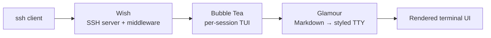

> **En bref :** Mon site était déjà un terminal dans un navigateur, alors j'ai construit le vrai aussi : `ssh stephan.zych.be` sert les mêmes pages À propos, Projets et Blog, en SSH. Pas de navigateur, pas de JavaScript. C'est une petite pile Go sur l'outillage de [Charm](https://charm.sh/) : Wish (serveur SSH), Bubble Tea (TUI), et Glamour (Markdown), qui lisent tous le même `content/` que le site web.

Le site que vous lisez est un terminal qui se déguise en navigateur. Catppuccin, JetBrains Mono, une palette de commande `:`, tout l'attirail. Ce n'était qu'une question de temps avant que quelqu'un pose la question évidente : *si ça ressemble à un terminal, pourquoi je ne peux pas juste m'y connecter en SSH ?*

Alors maintenant vous pouvez :

```bash
ssh stephan.zych.be
```

Pas de navigateur. Pas de JavaScript. Pas de polices web qui se font passer pour un TTY. Juste un programme Go envoyé dans une connexion SSH, qui rend exactement le même À propos, Projets et Blog que vous regardez en ce moment. Sauf que cette fois le terminal est réel.


## Voler l'idée, honnêtement

J'aimerais revendiquer l'originalité. Je ne peux pas.

[ThePrimeagen](https://www.youtube.com/c/theprimeagen) martèle depuis des années que « le terminal est la meilleure interface que vous ne shipperez jamais », et à un moment ça arrête d'être un mème et ça devient un cahier des charges. Puis [terminal.shop](https://www.terminal.shop/) est arrivé et a vendu du vrai café via `ssh terminal.shop` : une vraie boutique, un vrai paiement, zéro pixel. C'est le genre d'engagement déraisonnable envers une blague que je respecte, parce que la blague se révèle porteuse : SSH est un protocole applicatif éprouvé, chiffré, universellement installé, et on l'utilise surtout pour taper `git pull`.

Un site personnel est une cible à moins fort enjeu qu'un flux de paiement, ce qui en fait l'excuse parfaite pour découvrir comment fonctionne le tour de passe-passe.

## La pile est suspicieusement courte

Le tout, c'est l'outillage de [Charm](https://charm.sh/) qui fait le gros du travail :

- **[Wish](https://github.com/charmbracelet/wish)** : un serveur SSH que vous composez à partir de middlewares, de la même façon que vous construiriez une chaîne de handlers HTTP.
- **[Bubble Tea](https://github.com/charmbracelet/bubbletea)** : le framework TUI à architecture Elm (`Model`, `Update`, `View`) qui rend l'interface réelle.
- **[Glamour](https://github.com/charmbracelet/glamour)** : Markdown → sortie terminal stylée, donc mes articles de blog se rendent dans le TUI sans un second pipeline de contenu.

Empilé, la connexion traverse l'outillage de Charm tout droit :



Le discours de vente de Wish, c'est qu'une session SSH est *juste une autre façon de donner un terminal à un utilisateur*. Bubble Tea rend déjà vers un terminal. Donc vous boulonnez l'un à l'autre, et le même `Model` qui tourne localement tourne soudain pour n'importe qui sur internet muni d'un client `ssh`. Autrement dit tout le monde.

```go
s, err := wish.NewServer(
    wish.WithAddress(net.JoinHostPort(host, port)),
    wish.WithHostKeyPath(hostKey),
    wish.WithMiddleware(
        bm.Middleware(teaHandler),    // hand each session a Bubble Tea program
        activeterm.Middleware(),      // reject anything that isn't a real TTY
        lm.Middleware(),              // log connections
    ),
)
```

Voilà le serveur. La ligne intéressante, c'est `bm.Middleware(teaHandler)` : chaque session SSH entrante reçoit son propre programme Bubble Tea, dimensionné à *leur* fenêtre, tournant *leur* boucle d'événements. Cent personnes peuvent se connecter et chacune a un TUI isolé. La pile de middlewares se lit de bas en haut comme n'importe quel bon oignon, et `activeterm` ferme tranquillement la porte aux bots et aux coups de sonde scriptés qui n'apportent pas un terminal interactif.

## Un terminal, dimensionné à votre fenêtre

Le handler qui tourne par connexion, c'est là où la réalité spécifique à SSH fait surface. Vous devez demander au client la taille de son terminal, parce qu'il n'y a pas de viewport à mesurer :

```go
teaHandler := func(s ssh.Session) (tea.Model, []tea.ProgramOption) {
    pty, _, active := s.Pty()
    w, h := 80, 24
    if active {
        w, h = pty.Window.Width, pty.Window.Height
    }
    // ...build the model at that size
    return NewModel(c, d, err, w, h), []tea.ProgramOption{tea.WithAltScreen()}
}
```

`80×24` est le repli, évidemment. C'est la taille d'un VT100, et on n'échappe apparemment jamais à 1978. `tea.WithAltScreen()` bascule vers le buffer d'écran alternatif, le même que `vim` et `htop` utilisent, donc quand vous vous déconnectez votre scrollback est exactement là où vous l'avez laissé au lieu d'être enseveli sous mon logo ASCII.

## La partie dont je suis vraiment fier : une seule source de vérité

Voici la règle que j'ai refusé de briser : **je n'écris pas ma bio deux fois.**

Le build web (Eleventy + composants web Lit) et le build SSH (Go + Bubble Tea) sont des runtimes complètement différents qui ne partagent aucun code. Ce qu'ils *partagent*, c'est un répertoire (`content/`) plein de Markdown et de JSON. Le site web le lit au moment du build. Le TUI le lit au moment de la connexion :

```go
// Reload content per session so deploys without a restart still serve
// fresh data; fall back to the boot-time copy on error.
c, err := LoadContent(contentDir)
if err != nil {
    c, err = content, loadErr
}
```

Ce rechargement par session achète beaucoup pour peu : je peux modifier un projet, redéployer le contenu, et la *prochaine* connexion SSH voit le changement sans relancer le serveur ni déconnecter personne en cours de session. Le web et le terminal restent synchronisés parce qu'aucun des deux ne possède le contenu. Le répertoire `content/` le possède. Deux moteurs de rendu, un seul ensemble de faits. Éditez une fois, livrez aux deux.


## Où ça vit vraiment

Une démo sur votre laptop, c'est une chose ; un port SSH public, c'en est une autre. Ça tourne dans un conteneur **distroless** : une image de base sans shell, sans gestionnaire de paquets, sans busybox, *rien* que le binaire Go compilé. Si quelqu'un trouvait un jour une faille dans le TUI, il n'y a pas de `/bin/sh` qui attend de l'autre côté pour pivoter. Le binaire tourne sous un utilisateur non root, sur un système de fichiers racine en lecture seule, avec toutes les capacités Linux retirées.

Le port est l'astuce qui vaut le détour. Vous ne pouvez pas mettre un reverse proxy normal devant SSH : Caddy, Traefik et leurs amis routent via le SNI TLS, et **SSH n'a pas de SNI**. Il n'y a pas de nom d'hôte dans la poignée de main sur lequel basculer. Donc pas de proxy L7 ici. Le conteneur écoute sur un port `2222` non privilégié (lier `:22` signifierait tourner en root, non merci), et Docker publie ça sur le port 22 de l'hôte directement :

```yaml
ports:
  - "22:2222"
```

Le seul piège : le sshd *propre* de la machine doit d'abord déménager du port 22, sinon les deux se battent pour le port. Le SSH d'administration vit maintenant sur un autre numéro, derrière un firewall ; le port 22 appartient au site.

La même machine sert aussi le site web : un petit conteneur Caddy à côté du TUI, les deux lisant le même répertoire `content/`, devant un seul domaine avec du HTTPS automatique. (Le site web pourrait tout aussi bien vivre sur un CDN comme GitHub Pages ; j'ai choisi une seule machine parce que le serveur SSH avait déjà besoin d'un domicile et que j'aime déployer le tout avec un seul `docker compose up`.)

Les détails fastidieux-mais-essentiels que les démos sautent :

- **Les clés d'hôte sont votre identité. Traitez-les comme telle.** Le serveur présente une clé d'hôte à chaque connexion ; la régénérer à la légère et chaque visiteur reçoit le mur de la peur `REMOTE HOST IDENTIFICATION HAS CHANGED`. Elle est générée une fois et persistée dans un volume, jamais tournée sur un coup de tête.
- **Un serveur SSH public est un aimant à abus.** Les sessions inactives sont coupées, chaque session a un plafond de temps absolu, et il y a un plafond sur les connexions concurrentes, donc un script qui s'ennuie ne peut pas tenir la porte ouverte indéfiniment ni fork-bomber la machine.
- **Une session ne peut faire exactement qu'une chose : regarder mon CV.** Pas de shell, pas d'authentification, pas d'accès aux fichiers. `activeterm` rejette tout ce qui n'est pas un vrai terminal interactif, et un programme Bubble Tea est la surface d'attaque *entière*. C'est quand même un port ouvert sur internet, et vous le construisez comme tel.

## Allez-y, alors

C'est en ligne. Même contenu, moitié des dépendances, zéro navigateur :

```bash
ssh stephan.zych.be
```

Ou, si vous êtes déjà ici à cliquer comme en 2010, appuyez sur <kbd>:</kbd> et lancez `ssh`. Ça copiera la commande pour vous. Puis allez ouvrir un vrai terminal et voyez l'autre moitié de la blague.

---

*Même contenu, moitié des dépendances, zéro navigateur : `ssh stephan.zych.be`.*
