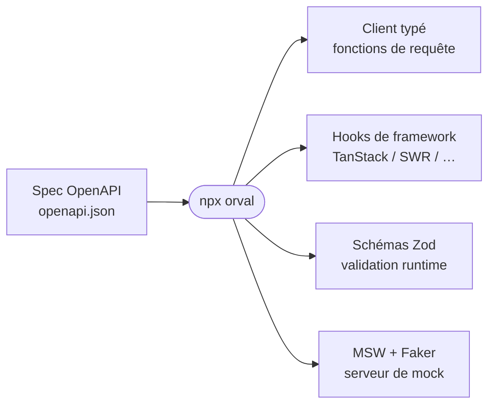

> **En bref :** le client API écrit à la main est le code le plus susceptible de mentir : il pourrit dès que le backend change. Votre backend émet déjà une spec **OpenAPI**, donc pointez [**Orval**](https://orval.dev/) vers elle et récupérez un client entièrement typé, des hooks de requête natifs à votre framework, des validateurs Zod et des serveurs de mock, régénérés à chaque changement de spec. Arrêtez de maintenir à la main la copie frontend du backend.

Voici une confession qui devrait faire rougir un architecte frontend : pendant des années, le code le plus sujet aux erreurs que j'aie expédié était la partie où je *décrivais le backend au frontend*. Un dossier de `types.ts` écrits à la main, un wrapper autour de `fetch`, une interface `User` qui disait `email: string` alors que l'API avait tranquillement commencé à renvoyer `email: string | null` trois sprints plus tôt. Personne ne mettait ce fichier à jour. Il pourrit. Et TypeScript compile votre mensonge avec confiance jusqu'à ce que la production renvoie `null` et que toute la carte explose.

La solution n'est pas la discipline. J'ai essayé la discipline. La solution est d'**arrêter d'écrire ce fichier à la main**, et de laisser le contrat du backend le générer lui-même. C'est tout le pitch d'[Orval](https://orval.dev/), et c'est discrètement devenu la première chose que j'installe sur tout projet avec une vraie API.

## Le contrat existe déjà, vous l'ignorez simplement

Tout framework backend sérieux peut émettre un **document [OpenAPI](https://www.openapis.org/)** : une description lisible par machine de chaque endpoint, chaque paramètre, chaque corps de requête, chaque forme de réponse, chaque enum. C'est du JSON ou du YAML, c'est versionné, et votre backend peut le produire automatiquement à partir du code qui est *déjà là*.

Ce document, c'est le contrat. Le problème n'a jamais été que le contrat n'existe pas. C'est qu'historiquement le frontend le réimplémentait à la main, dans un second langage, et les deux dérivaient dès que quelqu'un livrait. OpenAPI est la source de vérité partagée, juste là. Orval est la chose qui la lit et écrit la moitié frontend *pour vous*.

## Ce qu'Orval génère réellement

Pointez-le vers une spec (une URL, un `openapi.json` local, peu importe) et il émet un client TypeScript typé. Mais « client typé » sous-vend la chose. D'une seule spec, vous obtenez, en option, tout ceci :

- **Des fonctions de requête entièrement typées** pour chaque endpoint. Mauvais paramètre, mauvaise forme de corps, champ renommé : c'est une vaguelette rouge à la compilation, pas une alerte Sentry à deux heures du matin.
- **Des hooks de données natifs au framework.** Il génère du code idiomatique [TanStack Query](https://tanstack.com/query) (`react-query`), SWR, Vue Query, Svelte Query, Solid Query ou Angular, un hook par endpoint. Un `useListPets()` et un `useGetPetById()` qui connaissent déjà leurs propres types, clés de cache et formes d'erreur.
- **Des schémas [Zod](https://zod.dev/)** pour la validation à l'exécution, afin que la frontière où les données entrent réellement dans votre application soit vérifiée contre la spec, fermant l'écart entre « TypeScript pense que c'est un `User` » et « le réseau a réellement envoyé un `User` ».
- **Des handlers de mock [MSW](https://mswjs.io/) remplis de données [Faker](https://fakerjs.dev/).** C'est celui qui convertit les gens. Orval lit la spec et génère un faux serveur (des réponses à l'allure réaliste pour chaque endpoint), afin que le frontend puisse être construit et testé contre une API que *l'équipe backend n'a pas encore écrite*. Plus de blocage mutuel. La spec est la poignée de main, les deux côtés construisent en parallèle contre elle.

Une seule spec se déploie en éventail vers chaque artefact que vous devriez autrement maintenir à la main :



La config est un seul fichier et se lit à peu près comme on l'espérerait :

```ts
// orval.config.ts
import { defineConfig } from 'orval';

export default defineConfig({
  api: {
    input: 'https://api.example.com/openapi.json',
    output: {
      mode: 'tags-split',          // un dossier par tag d'API, pas un fichier de 9000 lignes
      target: 'src/api/generated',
      client: 'react-query',
      mock: true,                  // émet aussi les handlers MSW
      override: {
        mutator: { path: 'src/api/http.ts', name: 'http' }, // votre propre instance axios/fetch
      },
    },
  },
});
```

Ensuite la boucle, c'est juste : le backend livre un changement de spec → vous lancez `npx orval` → TypeScript s'allume partout où le contrat a bougé → vous réparez l'UI avec le compilateur qui vous tient la main. Branchez ça dans la CI et un client obsolète devient une *build en échec* plutôt qu'une surprise en production. Utiliser l'API ressemble à ceci, et c'est pareil dans chaque composant :

```ts
const { data, isLoading, error } = useListPets({ status: 'available' });
//      ^? Pet[]   : entièrement typé, de bout en bout, généré, jamais édité à la main
```

## La partie que je veux vraiment vous vendre : il se moque de votre backend

C'est là que ça arrête d'être « un sympathique outil React » et commence à être une décision d'**architecture**. Orval consomme de l'OpenAPI. Il ne sait pas, et ne se préoccupe pas de savoir, ce qui l'a produit. La spec est un format d'échange neutre, donc exactement le même pipeline de codegen frontend chevauche des stacks complètement différentes. J'ai maintenant fait les trois.

**Laravel.** Le côté PHP de mon monde. Vous n'écrivez pas l'OpenAPI à la main. Vous laissez [Scramble](https://scramble.dedoc.co/) l'inférer directement de vos controllers, form requests et API resources (pas d'annotations, il lit vos types), ou [Scribe](https://scribe.knuckles.wtf/) si vous préférez la route annotée. Dans les deux cas vous obtenez un `openapi.json` qu'Orval peut digérer :

```bash
php artisan scramble:export   # → openapi.json, directement depuis votre code existant
```

**Django / Wagtail.** Une API Django REST Framework avec [drf-spectacular](https://drf-spectacular.readthedocs.io/) génère un document OpenAPI 3 propre à partir de vos serializers et viewsets. Les configurations headless de Wagtail s'appuient sur la même couche DRF, ou sur [Django Ninja](https://django-ninja.dev/), qui est typé Pydantic de bout en bout et émet de l'OpenAPI par défaut. Pointez Orval vers le résultat et vos modèles Python deviennent des hooks React typés :

```bash
./manage.py spectacular --file openapi.yml
```

**Next.js / Node.** [NestJS](https://docs.nestjs.com/openapi/introduction) construit la spec à partir des décorateurs ; [Fastify](https://github.com/fastify/fastify-swagger) et [zod-openapi de Hono](https://hono.dev/examples/zod-openapi) la dérivent de vos schémas Zod, si bien que la validation à l'exécution *est* la documentation. Même quand toute la stack est en TypeScript, le codegen garde sa place : il garantit que le client correspond au contrat publié par le serveur plutôt qu'à ce que vous pensiez vous souvenir que le serveur faisait.

Trois langages, trois ORM, trois écosystèmes : **un seul pipeline frontend.** C'est la chose qui vaut la peine d'être intériorisée. Quand je passe d'un client Laravel à un build headless Wagtail puis à un service Node, la couche API de l'application React est *identique dans sa forme* : un dossier généré, un hook `react-query` par endpoint, des mocks MSW pour les tests. Le backend est un détail d'implémentation derrière une spec. Mes conventions frontend arrêtent d'être du folklore par projet et deviennent un boilerplate reproductible, ce qui, si vous avez lu mon [whoami](/fr/whoami/), est plus ou moins toute ma personnalité.

## Les compromis honnêtes

Ce n'est pas gratuit, et je vous vendrais du vent si je prétendais le contraire :

- **C'est de l'excès pour un prototype de week-end.** Trois endpoints et un `fetch` suffisent. Sortez cet outil quand il y a un vrai contrat, une vraie équipe, et un vrai coût à la dérive.
- **Vous héritez d'une dépendance d'exécution et d'un dossier généré** dans votre repo. Le code généré reste du code : committez-le, relisez les diffs, traitez `npx orval` comme une étape de build avec un propriétaire.
- **Une inférence de types lourde peut taxer l'IDE** sur de grosses specs, et les hooks TanStack générés enfouissent une partie de la gestion de réponse dans la librairie, donc un bug bizarre signifie parfois lire du code généré. Pénible. Toujours moins cher que le bug que ça évite.

Rien de tout ça ne contrebalance le gain principal. La dérive frontend-backend n'est pas un agacement d'outillage, c'est un **contrat cassé** : deux équipes en désaccord sur la réalité et qui le découvrent en production. Orval fait de la spec la seule source de vérité et la transforme en code frontend vivant, typé, mockable, qui se resynchronise avec une seule commande.

J'écris pas mal d'opinions sur l'outillage de build. Celle-ci est une des rares qui soit simplement *correcte* : arrêtez d'écrire à la main la chose qu'une machine peut dériver d'un document que votre backend publie déjà. Laissez la spec écrire le client.

---

*Références : [docs Orval](https://orval.dev/) · [orval sur npm](https://www.npmjs.com/package/orval) · [orval-labs/orval](https://github.com/orval-labs/orval) · générateurs de spec [Scramble](https://scramble.dedoc.co/), [drf-spectacular](https://drf-spectacular.readthedocs.io/), et [NestJS Swagger](https://docs.nestjs.com/openapi/introduction).*
