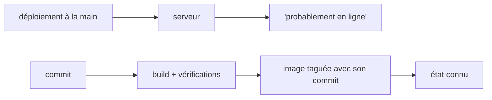
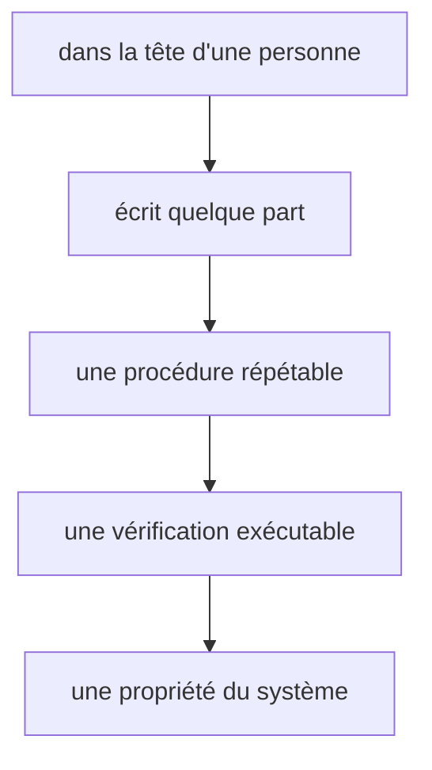

> **En bref :** *« Est-ce que c'est en ligne ? »* était autrefois une question pour la dernière personne qui avait touché au serveur. Aujourd'hui j'utilise la CI pour plus que des builds : c'est là que vont les décisions mécaniques dès que je suis fatigué de compter sur quelqu'un pour s'en souvenir correctement. La partie difficile est de savoir quelles décisions appartiennent là et lesquelles ont encore besoin d'une personne.

*« Est-ce que c'est en ligne ? »*

Pendant une bonne partie de ma carrière, la réponse honnête était la mémoire de quelqu'un. Les déploiements partaient à la main : connexion, upload, on espère. Si la personne qui l'avait fait était rentrée chez elle, on lisait les dates de modification des fichiers et on tirait ses propres conclusions. L'upload n'a jamais été la partie pénible. Trois minutes, quelques fois par semaine, personne ne l'a jamais mis sur un tableau de planning. La partie pénible, c'est qu'une question simple sur un système en production ne pouvait être répondue que par un humain, et seulement si cet humain se souvenait correctement.



C'est le motif que je retrouve sans cesse, sur mes propres projets comme sur quinze ans de projets d'autres gens. Pas « c'est inefficace ». Plutôt : ce fait existe, le système pourrait le porter, et à la place il vit dans une personne qui est actuellement dans un train.

## Rendre le déploiement ennuyeux

Mon site tourne en deux runtimes sur un seul répertoire `content/` : un build Eleventy servi par Caddy, et un TUI en Go qu'on peut [atteindre en SSH](/fr/blog/terminal-over-ssh/). Chaque push sur `main` construit les deux en images, et un job de déploiement réinitialise ensuite le checkout du serveur, tire les images et relance la stack. Le pipeline est un fichier dans le dépôt, ce qui veut dire que la façon dont ce truc se déploie est lisible par quiconque ouvre le dépôt ensuite, moi inclus dans deux ans.

Chaque image reçoit deux tags : `latest`, et le SHA du commit qui l'a produite. Le second est celui qui compte, parce que « qu'est-ce qui tourne réellement ? » devient une recherche plutôt qu'un interrogatoire.

Je vais être honnête sur la faille, parce que c'est un bon exemple de la façon dont ces choses se passent vraiment. Mon fichier compose tire encore `:latest`, alors que les images de base dans les deux Dockerfiles sont épinglées par digest. Le code tiers est verrouillé plus fort que le mien, et il reste exactement un endroit où la version en cours est une cible mouvante. Le tag SHA existe, la discipline pour le consommer n'existe pas encore.

## Puis le pipeline a commencé à se souvenir d'autres choses

Si le déploiement était tout ce que faisait la CI, ce serait un `rsync` un peu grandiloquent. Ce qui la rend vraiment utile, c'est qu'un pipeline est un endroit correct pour garder des décisions.

```text
push sur main
├── build des images (web, tui)
├── contenu : posters + jumeaux og présents ?
├── cohérence : cv, raccourcis clavier
├── architecture : les règles de couches tiennent encore ?
├── tests + harnais clavier
└── déploiement  ← ne tourne que si tout ce qui précède passe
```

Une seule de ces étapes est un build. Le reste, ce sont des règles que j'étais fatigué de répéter en revue de code.

**Vérifications réservées à la release.** Chaque billet ici a besoin d'un poster en `.webp` et d'un jumeau en `.jpg` pour `ogImage`, parce que le crawler de LinkedIn rend les aperçus WebP de façon peu fiable, et qu'un billet avec seulement de l'art WebP part sans aucun aperçu. La décision intéressante n'était pas de vérifier ou non, mais où. L'endroit évident est le build, et c'est faux : j'écris les billets sur plusieurs soirées et, pendant la majeure partie de ce temps, l'art n'existe pas, donc un build qui refuse de tourner avant que j'aie fait un poster punit la version de moi en train de rédiger pour protéger la version de moi en train de publier. Des jours différents, et un seul des deux a une échéance. Donc ça tourne comme son propre job, qui bloque la release et rien d'autre, et il affiche la commande qui corrige ça.

**Vérifications de cohérence.** Le sens d'un raccourci clavier vit vraiment en trois endroits ici : le keymap web, la table de touches du TUI, et le fichier JSON dont la prose s'affiche dans les deux runtimes. Trois représentations d'une seule décision, dont aucune ne peut voir les autres. Je n'ai pas écrit de vérificateur parce que ça semblait propre ; j'en ai écrit un parce que ça avait déjà mal tourné. L'ancienne table d'aide du TUI annonçait *« esc / h / q → retour »* alors que `q` sur l'écran d'accueil quittait purement et simplement, et une décision d'accessibilité sur les raccourcis à un seul caractère était redérivée sur huit points d'appel différents, dont un avec une erreur. Rien d'autre dans le dépôt ne pouvait voir ni l'un ni l'autre bug, parce qu'être attentif dans trois fichiers à la fois est exactement ce que les gens font mal.

**Vérifications d'architecture.** La plus vicieuse. Les couches clavier et overlay ont été centralisées parce que treize listeners `keydown` indépendants avaient grandi en parallèle, chacun redérivant « ai-je le droit de traiter cette touche maintenant ? » et chacun obtenant une réponse subtilement différente. Ce refactor était la moitié facile ; la moitié difficile, c'est que la même chose repousse. Donc une vérification applique maintenant la forme : des listeners globaux uniquement dans quatre fichiers nommés, chacun nommé avec la raison pour laquelle il est autorisé. « Merci de vous rappeler notre convention » et « le dépôt sait que c'est une convention » ne sont pas la même phrase, et une seule des deux survit à un jeudi chargé et à un nouveau contributeur.

**Des règles que j'ai délibérément refusé d'encoder.** Une règle dans le même contrat dit *le câblage compose, il n'accumule jamais de données métier*. Vraie règle, vraiment importante, et chaque approximation mécanique que j'ai essayée signalait du code parfaitement légitime. Une vérification qui crie au loup se fait commenter dans le mois, emportant avec elle les bonnes vérifications voisines. Celle-là reste une règle de revue.

Tout ce qui échoue ne devrait pas non plus arrêter une release. Le scan de vulnérabilités rapporte à chaque push sans bloquer le déploiement, et la vérification des raccourcis clavier n'avertit que si le *libellé* diffère plutôt que les touches elles-mêmes. Un nouvel avis sur une dépendance transitive vaut la peine d'être connu un mardi matin et ne vaut pas la peine de bloquer un correctif de typo à minuit. Distribuer des vetos généreusement, c'est comme ça qu'une équipe apprend à cliquer sur « merge quand même ».

## Le même problème, sans le YAML

Rien de tout ça ne concerne vraiment des pipelines. Chaque équipe avec laquelle j'ai travaillé a une poignée de faits qui n'existent que dans la tête de quelqu'un, et ils suivent un chemin assez prévisible pour en sortir :



Toutes les règles ne devraient pas faire tout le trajet. Beaucoup s'arrêtent à « écrit » parce que le jugement est le point, et forcer ça dans un script, c'est comme ça qu'on obtient un logiciel qui applique des âneries avec une grande fiabilité. Mais les règles mécaniques restent coincées deux étapes trop tôt, et on peut les repérer aux questions que les gens se posent entre eux.

Les déploiements manuels sont le cas évident, et ils sont partout : une release part, et le seul enregistrement est dans la tête de qui l'a fait, plus un message dans un canal qui a défilé. L'onboarding, c'est la même forme un cran plus haut. Sur la plupart des projets que j'ai rejoints, la connaissance nécessaire pour être opérationnel existait, était exacte, et vivait dans un seul développeur, ce qui fonctionne magnifiquement jusqu'à ce qu'il soit en vacances pendant la première semaine d'un nouvel arrivant. Un README aide. Un script qui provisionne la chose peut aider davantage, parce qu'au moins ses hypothèses sont exercées chaque fois que quelqu'un le lance.

Ensuite il y a la famille des vérifications que les gens font parce que le système ne dit rien sur lui-même. Est-ce déployé ? Quelle version est en staging ? L'import a-t-il tourné cette nuit ? Ce formulaire est-il cassé depuis vendredi ? Chacune de ces questions est un fait qu'un système pourrait publier et ne publie pas, donc un humain vérifie manuellement, à des intervalles qu'il a inventés, et qu'il oublie parfois. Ce n'est pas un problème de discipline, c'est une décision de conception que personne n'a prise exprès.

Celle pour laquelle j'ai le moins de patience, c'est le statut de release qu'on copie à la main. Un déploiement se produit dans un système, quelqu'un déplace ce fait vers l'outil de suivi du projet, quelqu'un d'autre le relaie au client. Trois systèmes, un fait, deux humains employés comme transport. Le support fait le même travail en sens inverse, lisant deux écrans et un fil de discussion pour répondre à une question. Les gens font un mauvais middleware, et le correctif est rarement subtil : publier l'état une fois et laisser tout le monde regarder la même chose.

Ce qui vaut la peine d'être défendu, c'est la ligne entre ce transport et le véritable jugement.

```text
machine                    humain

l'asset existe-t-il ?            est-ce que ce changement a du sens ?
les définitions ont-elles dérivé ?  ce risque est-il acceptable ?
les tests sont-ils passés ?       qu'est-ce que le client doit savoir ?
```

Déplacer un fait entre systèmes, c'est du transport, et un mauvais usage d'une personne. Expliquer ce qu'un changement signifie pour le business de quelqu'un, décider quel risque est acceptable, remarquer qu'un chiffre a l'air bizarre : c'est là qu'un humain a sa place, et l'automatiser parce qu'on le peut techniquement, c'est comme ça qu'on se retrouve avec un pipeline efficace qui produit des rapports que personne ne lit. Distinguer les deux est la vraie compétence, et ce n'est pas toujours évident lequel est lequel.

## La documentation, là où les règles vont devenir des suggestions

Je ne suis pas anti-documentation, et je serais un hypocrite si c'était le cas : l'une de mes propres vérifications fait échouer le build quand un répertoire de fonctionnalité n'a pas de README. Un README est là où va la raison d'être. Pourquoi cette couche existe, ce qu'on a essayé en premier, quel compromis on a accepté, à quoi vous devriez penser avant de changer ça. Aucun script ne peut fournir ça.

La CI récupère la moitié mécanique, et la propriété que j'en attends est celle que j'ai [défendue ailleurs](/fr/blog/four-things-to-run-a-machine/) : le code de sortie vaut la vérité, pas de négociation après coup. D'après mon expérience, une règle qu'une machine pourrait vérifier et ne vérifie pas est suivie religieusement un moment, puis de façon inconstante, puis redécouverte en revue par quelqu'un qui cite un document ouvert pour la dernière fois en 2022.

## La mauvaise version, que je suis bien qualifié pour construire

Rien de tout ça n'a rendu quoi que ce soit plus simple. Ça a déplacé la complexité hors des habitudes des gens et dans un pipeline que je maintiens désormais, et c'est généralement le bon compromis, mais c'est un compromis. Décider où la complexité se pose est en grande partie ce qu'est réellement l'architecture. La question n'est pas « est-ce plus simple ? » mais « qui la porte maintenant ? »

Ratez ça et vous construisez l'autre chose. J'aime construire des outils, ce qui est précisément le problème : c'est très facile de passer quatre heures à retirer une irritation de deux minutes et de classer ça sous levier. Naturellement, le script a ensuite eu besoin d'un fichier de configuration. Après ça il a eu besoin d'un court README. C'est maintenant un petit produit interne avec exactement un utilisateur, et cet utilisateur est en vacances la semaine prochaine. La plupart des agences en ont trois comme ça, et chacun est l'animal de compagnie de quelqu'un.

L'échec plus subtil est qu'automatiser une étape peut retirer la seule occasion que quelqu'un avait de remarquer que quelque chose n'allait pas. Parfois une revue manuelle compte parce qu'elle force un humain à regarder la chose. Parfois écrire la mise à jour hebdomadaire est utile parce que l'écrire pousse quelqu'un à penser au statut plutôt qu'à le rapporter. Retirez l'écriture et la pensée s'en va discrètement avec elle, pendant que le tableau de bord reste vert. Lisanne Bainbridge a fait cet argument sur les salles de contrôle industrielles en 1983 dans [*Ironies of Automation*](https://gwern.net/doc/sociology/technology/1983-bainbridge.pdf) : automatisez le travail routinier et vous retirez la pratique qui gardait un opérateur affilé, puis laissez-le responsable de l'urgence rare qui nécessite le plus de compétence. La moitié inconfortable de cet argument se transpose assez bien sur la livraison logicielle.

C'est pour ça qu'une coche verte mérite moins de crédit qu'elle n'en reçoit. Elle vous dit qu'un processus s'est terminé, ce qui est [le même piège](/fr/blog/terminal-agent-workbench/) que je retrouve sans cesse du côté de la revue. C'est toute la prétention qu'elle porte, et elle continuera à la porter longtemps après que la pensée aura quitté le bâtiment.

## La journée de qui ça facilite réellement ?

C'est la question que je pose avant de construire quoi que ce soit de tout ça, et la réponse doit être une personne faisant quelque chose un après-midi précis. Pas « l'ingénierie », pas « l'équipe ».

La vérification de poster, c'est pour moi à onze heures du soir, en train de rédiger sans art, et pour la version de moi qui publie trois semaines plus tard et qui livrerait sinon un aperçu cassé. La vérification de cohérence, c'est pour le lecteur qui a appuyé sur `q` en s'attendant à revenir en arrière. La vérification d'architecture, c'est pour quiconque héritera de ce dépôt en mars et ajoutera un listener keydown en toute bonne foi. Le SHA sur l'image, c'est pour quiconque essaie de comprendre ce qui tourne, moi probablement, à une heure déraisonnable.

Chacune nomme quelque chose qu'une personne n'a plus à se rappeler, reconstruire, transporter ou deviner. Quand je ne peux pas nommer cette personne, on vient généralement de me tendre une solution en me demandant de la construire plus vite.

## Alors, est-ce en ligne ?

Il y a quinze ans, c'était une question pour quiconque avait uploadé les fichiers, et la réponse se situait entre « probablement » et « laisse-moi vérifier les dates ». Maintenant le pipeline y répond, ou y répond aussi bien que mon tag `:latest` restant le permet, ce qui est une phrase que je devrais transformer en commit plutôt qu'en paragraphe.

C'est à peu près ce que je veux de la CI : pas plus de YAML, et certainement pas une plateforme. Moins de faits qui ne sont vrais que parce que quelqu'un s'en est souvenu.

---

*Référence : Lisanne Bainbridge, [« Ironies of Automation »](https://gwern.net/doc/sociology/technology/1983-bainbridge.pdf), Automatica 19(6), 1983. Le pipeline et les vérifications décrits ici sont dans [le dépôt de ce site](https://github.com/monkeymonk/stephan.zych.be).*
